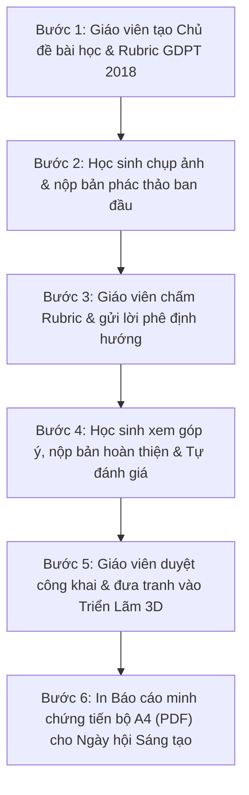

# 🎨 ArtProgress — Cẩm Nang Hướng Dẫn Sử Dụng & Quy Trình Thực Hiện
> **Hệ thống Quản lý Hồ sơ Mỹ thuật, Đánh giá Tiến bộ & Phòng Triển lãm 3D THCS**  
> *Dự án Chuyển đổi số Dạy & Học môn Mĩ thuật theo Chương trình GDPT 2018*

---

## 📌 Lời Nói Đầu Của Học Sinh Thực Hiện Dự Án

Kính gửi **Thầy/Cô Giáo viên Mĩ thuật**,

Em xây dựng dự án **ArtProgress** với mong muốn đồng hành cùng Thầy/Cô trong công tác giảng dạy, chấm bài và lưu giữ những khoảnh khắc sáng tạo nghệ thuật quý giá của các bạn học sinh. 

Phần mềm được thiết kế theo đúng tinh thần **"Đánh giá vì sự tiến bộ của người học" (Assessment for Learning)** trong Chương trình Giáo dục Phổ thông 2018:
1. Mỗi học sinh đều có một hồ sơ mĩ thuật cá nhân (*Art Portfolio*), lưu trữ chặng đường từ nét vẽ phác thảo đầu tiên cho đến bức tranh hoàn thiện.
2. Thầy/Cô có công cụ chấm điểm theo bảng tiêu chí (*Rubric*) 4 chuẩn năng lực rõ ràng, ghi lời phê động viên mang tính sư phạm.
3. Các bức tranh tiêu biểu được đưa lên **Phòng Triển Lãm Ảo 3D** hiện đại với ánh sáng và khung tranh mỹ thuật, giúp học sinh thêm tự hào và say mê sáng tạo.
4. **Cơ chế lưu trữ an toàn & Tự động dọn cache (v1.5.0)**: Hệ thống sử dụng bộ nhớ đệm kép (kết hợp `LocalStorage` và `IndexedDB`) chống tràn dung lượng khi lưu nhiều bài vẽ, đồng thời tự động kiểm tra mã phiên bản tại `src/config/version.ts`. Nếu phát hiện người dùng đang dùng phiên bản cũ do cache trình duyệt, hệ thống sẽ tự động dọn sạch bộ nhớ đệm và reload mới hoàn toàn.

Tài liệu này sẽ hướng dẫn Thầy/Cô và các bạn học sinh từng bước vận hành hệ thống một cách dễ dàng và hiệu quả nhất.

---

## 🧭 Tổng Quan Kiến Trúc Hệ Thống

Hệ thống tích hợp đầy đủ cơ cấu tổ chức của một trường THCS tiêu chuẩn:
- **4 Khối học**: Khối 6, Khối 7, Khối 8, Khối 9.
- **16 Lớp học**: Mỗi khối gồm 4 lớp (ví dụ: `6A1`, `6A2`, `6A3`, `6A4` ... `9A4`).
- **3 Phân quyền người dùng**:
  - 🎓 **Cổng Giáo viên**: Toàn quyền quản lý học sinh, tạo bài học, chấm điểm Rubric, duyệt bài triển lãm và in báo cáo tiến bộ sư phạm A4.
  - 🎨 **Cổng Học sinh**: Chọn danh tính cá nhân, nộp bài vẽ, so sánh tranh Trước/Sau bằng thanh trượt, viết tự đánh giá.
  - 🏛️ **Cổng Khách tham quan**: Mở cửa tự do cho Phụ huynh, Ban Giám hiệu và các bạn học sinh khám phá Phòng Triển Lãm 3D.
- 🖌️ **Hiệu ứng nhận diện đặc trưng**: Khi bấm đăng nhập, một vệt cọ vẽ nghệ thuật tông màu son đất nung `#C4572F` sẽ lướt qua màn hình trong 2.3 giây (1.0s quét phủ $\rightarrow$ 0.8s giữ dấu ấn $\rightarrow$ 0.5s trượt về), tạo cảm giác như bắt đầu bước vào một xưởng vẽ thực thụ.

---

## 🔄 Quy Trình Sư Phạm 6 Bước (Vòng Đời Một Bài Học Mĩ Thuật)



---

## 📖 Hướng Dẫn Chi Tiết Theo Từng Vai Trò

### I. DÀNH CHO GIÁO VIÊN MĨ THUẬT

#### 1. Đăng nhập hệ thống
1. Tại màn hình chính, chọn tab **"Giáo Viên"**.
2. Nhập mã PIN sư phạm do nhà trường hoặc quản trị viên cung cấp (được cấu hình an toàn qua biến môi trường `NEXT_PUBLIC_TEACHER_PIN`).
3. Bấm nút **"Đăng nhập"**. Vệt cọ vẽ `#C4572F` sẽ quét qua màn hình và mở ra Bảng điều khiển dành riêng cho Giáo viên.

#### 2. Quản lý 4 Khối & 16 Lớp học
- Trên thanh điều hướng bên trái:
  - Bấm chọn Khối lớp: **K6**, **K7**, **K8**, **K9**.
  - Chọn lớp học cụ thể (ví dụ: `Lớp 7A1`).
  - Hệ thống sẽ lập tức lọc toàn bộ học sinh, chủ đề và bài vẽ thuộc đúng lớp đó.
- Bấm nút **"Danh sách HS"** để:
  - Xem sĩ số và danh sách tên, mã số học sinh của lớp.
  - Thêm một học sinh mới (`+ Thêm mới`).
  - **Nhập nhanh hàng loạt**: Thầy/Cô chỉ cần copy danh sách tên học sinh từ Excel rồi dán vào, hệ thống sẽ tự động tạo tài khoản và sinh mã số (`HS7A1_01`, `HS7A1_02`...).

#### 3. Tạo Chủ đề bài học mới & Thiết lập Rubric
1. Chọn mục **"Chủ đề học tập"** trên thanh menu.
2. Bấm nút **"+ Tạo bài học mới"**.
3. Điền các thông tin:
   - Tên chủ đề bài học (ví dụ: *Hòa sắc thiên nhiên quê hương*, *Thiết kế bìa sách*).
   - Yêu cầu cần đạt theo chương trình GDPT 2018.
   - **Bảng Rubric 4 tiêu chí cốt lõi**:
     - *Bố cục & Trọng tâm* (Mặc định 25%)
     - *Đường nét & Tạo hình* (Mặc định 25%)
     - *Màu sắc & Hòa sắc* (Mặc định 30%)
     - *Sáng tạo & Cảm xúc* (Mặc định 20%)
     - *(Thầy/Cô có thể tùy chỉnh tên tiêu chí và trọng số, miễn là tổng bằng 100%)*.
4. Bấm **"Lưu bài học"**. Thầy/Cô có thể bấm nút **"Đang mở nhận bài" / "Đã khóa"** để kiểm soát thời hạn nộp bài của học sinh.

#### 4. Đánh giá, Chấm điểm Rubric & Phê duyệt bài vẽ
1. Trong mục **"Hồ sơ bài vẽ"**, chọn bài vẽ của học sinh cần chấm.
2. Tại bảng đánh giá sư phạm bên phải:
   - **Kéo các thanh trượt Rubric** tương ứng với từng tiêu chí để cho điểm.
   - **Ghi lời phê sư phạm định hướng**: Nhấp chuột vào ô nhận xét để bổ sung lời động viên hoặc hướng dẫn sửa nét/màu cụ thể cho em học sinh đó.
   - Bấm nút **"Duyệt lời phê"** để gửi kết quả về cho học sinh.
3. **Đưa tranh vào Triển lãm 3D**:
   - Khi bài vẽ đạt chất lượng tốt, Thầy/Cô gạt nút **"Công khai triển lãm"** sang màu xanh. Bức tranh sẽ tự động xuất hiện trên tường danh dự của Phòng Triển Lãm 3D!

#### 5. Xuất bản Báo cáo Minh chứng Tiến bộ In Khổ A4 (PDF)
1. Tại góc trên bên phải trang chi tiết bài vẽ, bấm nút **"Xuất báo cáo PDF"**.
2. Một bảng tổng kết sư phạm hoàn chỉnh sẽ hiện ra bao gồm:
   - Ảnh so sánh bản vẽ Trước và bản vẽ Sau.
   - Điểm số Rubric chi tiết theo 4 tiêu chí.
   - Nhận xét chính thức của Giáo viên.
   - Lời tự đánh giá & cảm nghĩ của Học sinh.
3. Bấm **"In báo cáo / Lưu PDF (A4)"**:
   - Hệ thống tự động ẩn toàn bộ thanh menu giao diện, căn chỉnh kích thước chuẩn xác theo khổ giấy A4 dọc để Thầy/Cô in ra giấy hoặc lưu thành file PDF làm hồ sơ lưu trữ kiểm tra chuyên môn.

---

### II. DÀNH CHO HỌC SINH

#### 1. Đăng nhập xưởng vẽ cá nhân
1. Tại màn hình chính, chọn tab **"Học Sinh"**.
2. Chọn Khối học của mình (K6, K7, K8 hoặc K9).
3. Chọn Lớp học (ví dụ: `7A1`).
4. Bấm chọn tên mình trong danh sách học sinh (hoặc gõ tên vào ô tìm kiếm). Mỗi bạn học sinh sẽ có một màu sắc sắc tố mỹ thuật riêng biệt (*Atelier Pigment*).
5. Bấm **"Vào phòng học"**. Vệt cọ vẽ `#C4572F` sẽ lướt qua đưa bạn vào phòng vẽ riêng.

#### 2. Nộp bài vẽ lần đầu (Bản phác thảo hoặc bài vẽ ban đầu)
1. Bấm nút **"+ Nộp tác phẩm"** (nút màu cam nổi bật).
2. Chọn bài học tương ứng.
3. Đặt tên cho bức tranh và viết vài dòng giới thiệu về ý tưởng của mình.
4. Tải ảnh chụp bức tranh vẽ từ điện thoại hoặc máy tính lên.
   > 💡 *Mẹo: Hệ thống tự động nén ảnh thông minh, giúp ảnh tải lên nhanh chóng mà vẫn giữ nguyên màu sắc sống động.*
5. Bấm **"Nộp tác phẩm"**.

#### 3. Tiếp thu góp ý & Nộp bản vẽ cải tiến (Bản hoàn thiện)
1. Sau khi Giáo viên xem và gửi nhận xét, bài vẽ sẽ hiển thị lời phê của Thầy/Cô cùng điểm Rubric.
2. Em lắng nghe nhận xét, chỉnh sửa lại bức tranh thực tế của mình cho đẹp hơn.
3. Bấm nút **"Nộp bản vẽ cải tiến"** để tải lên bức tranh đã được chỉnh sửa.
4. **Khám phá thanh trượt so sánh Trước - Sau (`Before / After Slider`)**:
   - Kéo thanh trượt qua lại giữa 2 bức tranh để tự mình chiêm ngưỡng sự tiến bộ rõ rệt qua từng nét vẽ và mảng màu!
5. Viết một đoạn cảm nghĩ vào ô **"Tự đánh giá của học sinh"** (chia sẻ điều em hài lòng nhất và bài học rút ra).

#### 4. Khám phá Phòng Triển Lãm 3D
- Bấm mục **"Triển Lãm 3D"** trên thanh menu để bước vào không gian bảo tàng nghệ thuật của trường.
- Tìm bức tranh của mình và của các bạn được treo trang trọng trên tường phòng tranh!

---

### III. DÀNH CHO KHÁCH THAM QUAN & PHỤ HUYNH

1. Tại màn hình đăng nhập, bấm tab **"Khách"**.
2. Bấm nút **"Vào Triển Lãm"** (Mở cửa tự do, không cần mật khẩu).
3. **Cách di chuyển trong không gian 3D**:
   - **Trên máy tính**:
     - Nhấn giữ chuột trái và di chuyển chuột để xoay góc nhìn camera 360 độ quanh phòng.
     - Dùng các phím `W`, `A`, `S`, `D` hoặc các phím mũi tên `↑`, `←`, `↓`, `→` để bước đi tới, lui, trái, phải trong phòng tranh.
     - Nhấp đúp chuột vào bất kỳ bức tranh nào trên tường để nhân vật tự động bước đến gần và ngắm nhìn chính diện bức tranh đó.
   - **Trên điện thoại / Máy tính bảng**:
     - Giao diện phòng tranh tự động mở rộng bao trọn toàn màn hình, thanh menu bên trái ẩn gọn gàng (bấm nút Menu góc trên trái để mở lại danh mục).
     - Hỗ trợ cảm ứng đa điểm (Multi-touch): Một ngón tay nhấn giữ cụm phím điều khiển ảo để bước đi, ngón tay còn lại vuốt trên màn hình để xoay hướng nhìn cùng lúc.
     - Thanh chuyển nhanh tranh được thu gọn cân đối ở cạnh dưới màn hình, không che khuất phím di chuyển.
     - *Khuyến khích xoay ngang điện thoại*: Hệ thống tự động thích ứng tỉ lệ màn hình ngang, mở rộng góc nhìn toàn cảnh (Panorama) và chống giật/kẹt zoom trang.
4. **Xem chi tiết tác phẩm & Không gian triển lãm**:
   - Khi đứng trước một bức tranh, một biển tên đồng nghệ thuật sẽ hiện rõ tên tác phẩm, tác giả và lớp học (đã loại bỏ tiền tố thừa, hiển thị ngắn gọn như `7A1`).
   - Hệ thống đèn âm trần tự động phân bổ đều theo chiều dài phòng tranh khi số lượng tác phẩm tăng lên, đảm bảo ánh sáng rực rỡ và chân thực.
   - Bấm nút **"👁️ Xem chi tiết"** để mở bảng phóng to bức tranh, xem bảng điểm Rubric và lời nhận xét của giáo viên.

---

## 🛠️ Hướng Dẫn Kỹ Thuật Dành Cho Quản Trị Viên / Học Sinh Vận Hành

### 1. Khởi chạy ứng dụng trên máy tính
- Yêu cầu: Đã cài đặt [Node.js](https://nodejs.org) (phiên bản 18 trở lên).
- Mở thư mục dự án trong Terminal/PowerShell và chạy lệnh:
  ```bash
  npm run dev
  ```
- Mở trình duyệt web truy cập địa chỉ: `http://localhost:3000`.

### 2. Triển khai trực tuyến lên Internet (Để giáo viên và cả lớp cùng dùng)
- Dự án được xây dựng bằng **Next.js 16.4.3** hiện đại nhất (đã cập nhật đầy đủ các bản vá bảo mật chính thức), sẵn sàng để đưa lên dịch vụ miễn phí như **Vercel** hoặc **Firebase Hosting**:
  1. Đưa mã nguồn lên GitHub (`git push origin main`).
  2. Kết nối tài khoản GitHub với Vercel hoặc triển khai tĩnh qua Firebase Hosting:
     ```bash
     npm run build
     firebase deploy --only hosting
     ```
  3. Sau 1 phút, trường sẽ có một đường link web riêng (ví dụ: `https://mithuatso.web.app`) để toàn trường có thể mở trên điện thoại hay máy tính mọi lúc mọi nơi!

### 3. Cơ chế kiểm soát phiên bản & Bộ nhớ đệm kép IndexedDB (Cấu hình tại `src/config/version.ts`)
- **Phiên bản hiện tại**: `1.5.0` (khai báo tập trung duy nhất tại `src/config/version.ts`).
- **Bộ nhớ đệm kép chống tràn Quota (IndexedDB + LocalStorage Safe-Wrapper)**: Tự động lưu trữ bài vẽ dung lượng lớn vào IndexedDB (`src/lib/storage-cache.ts`), giải quyết triệt để giới hạn 5MB của LocalStorage, giúp lưu trữ hàng trăm bức tranh phân giải cao mà không bao giờ gặp lỗi `QuotaExceededError`.
- **Tự động reload sạch**: Khi người dùng mở trang, nếu phát hiện phiên bản trong máy cũ hơn bản phát hành mới, hệ thống tự động dọn sạch cache cũ, đồng bộ phiên bản mới và reload trang để nạp bản mới nhất, tránh tình trạng lỗi giao diện do cache trình duyệt lưu trữ mã nguồn cũ.
- **Lưu trữ cục bộ an toàn**: Tự động lưu trữ bài vẽ và danh sách lớp học offline, không sợ mất dữ liệu kể cả khi trường học mất mạng.

---

## 💡 Mẹo Để Có Những Bức Tranh Lên Khung 3D Đẹp Nhất

1. **Góc chụp**: Đặt bức tranh trên mặt bàn phẳng hoặc gắn nhẹ lên bảng, giữ điện thoại vuông góc trực diện với mặt tranh để tránh bị méo góc.
2. **Ánh sáng**: Chụp tranh ở nơi có ánh sáng tự nhiên đầy đủ (gần cửa sổ hoặc dưới đèn học), tránh bóng đổ của tay hoặc điện thoại đè lên mặt tranh.
3. **Cắt biên**: Cắt gọn 4 mép giấy để bức tranh khi nạp vào khung gỗ sồi và nẹp vàng 3D sẽ ôm khít 100%, tạo cảm giác như một tác phẩm mỹ thuật chuyên nghiệp tại bảo tàng.

---

## 💖 Lời Cảm Ơn

Em xin chân thành cảm ơn **Thầy/Cô Giáo viên Mĩ thuật** đã truyền cảm hứng yêu thích hội họa cho chúng em, và tạo điều kiện để em đem niềm đam mê công nghệ ứng dụng vào môn học mĩ thuật ý nghĩa này.

Chúc Thầy/Cô có những tiết dạy ngập tràn niềm vui và chúc các bạn học sinh có thêm thật nhiều tác phẩm nghệ thuật tuyệt vời cùng **ArtProgress**!
