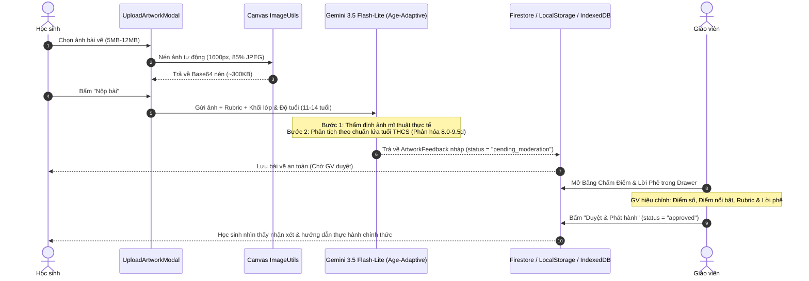

# TÀI LIỆU CẤU TRÚC & ĐẶC TẢ HỆ THỐNG DỰ ÁN (PROJECT SPECIFICATION)
## ArtProgress AI — Mĩ Thuật Tiến Bộ Số (GDPT 2018)

* **Tên dự án**: ArtProgress AI (Mĩ thuật tiến bộ số)
* **Mục tiêu**: Nền tảng Đánh giá Tiến bộ Sư phạm & Hồ sơ Sáng tạo Mĩ thuật THCS theo Chương trình GDPT 2018 (Phục vụ Ngày hội Giáo viên Sáng tạo 2026).
* **Nền tảng**: Web Application (Next.js 16.4.3 Static Export trên Firebase Hosting).
* **Trạng thái**: Hoàn thiện toàn bộ các module cốt lõi, 19/19 test tự động PASS.

---

## 1. CẤU TRÚC THƯ MỤC DỰ ÁN (DIRECTORY TREE & FILE ROLES)

```
d:\webgd\
├── .agents\                             # Cấu hình kỹ năng chuyên môn cục bộ (Skill taste, domain-modeling...)
├── public\                             # Tài nguyên tĩnh (ảnh mẫu, favicon, logo, background desktop/mobile)
├── src\
│   ├── app\
│   │   ├── actions\
│   │   │   └── artwork.ts              # Server/Client Action xử lý nộp bài và gọi phân tích AI
│   │   ├── favicon.ico
│   │   ├── globals.css                 # CSS toàn cục + Tailwind CSS v4 / Turbopack
│   │   ├── layout.tsx                  # Root Layout thiết lập font chữ, metadata và viewport chống kẹt zoom
│   │   └── page.tsx                    # Controller & Giao diện chính đa bảng (Workspace, Sidebar, Drawer)
│   ├── components\
│   │   ├── ArtistPaintingAnimation.tsx # Hoạt ảnh Người họa sĩ đang vẽ tranh cho màn hình đăng nhập
│   │   ├── BeforeAfterViewer.tsx       # Trình đối sánh Trước - Sau (Interactive Slider & Side-by-Side)
│   │   ├── FeedbackCard.tsx            # Thẻ hiển thị nhận xét Rubric, lời phê GV và cảnh báo ảnh không hợp lệ
│   │   ├── Gallery3DView.tsx           # Không gian Triển lãm 3D Three.js (Hệ thống đèn trần động, nhãn lớp sạch)
│   │   ├── LoginPage.tsx               # Cổng đăng nhập phân quyền 3 vai trò (Thích ứng Desktop/Mobile)
│   │   ├── ProgressReportModal.tsx     # Báo cáo tiến bộ sư phạm chuẩn in ấn A4 (@media print)
│   │   └── UploadArtworkModal.tsx      # Modal nộp bài vẽ kèm bộ nén ảnh Canvas tự động
│   ├── config\
│   │   └── version.ts                  # Khai báo phiên bản hệ thống tập trung Single Source of Truth (v1.5.0)
│   ├── lib\
│   │   ├── __tests__\
│   │   │   └── artprogress.node-test.mjs # Bộ kiểm thử tự động 19 tiêu chí sư phạm & kỹ thuật (Node test runner)
│   │   ├── firebase.ts                 # Cấu hình Firebase SDK, Firestore CRUD, Storage và Graceful Fallback
│   │   ├── gemini.ts                   # Tích hợp Gemini Vision (Dual-Model: 3.5 Flash-Lite tự động fallback 3.1 Flash-Lite)
│   │   ├── image-utils.ts              # Nén ảnh Canvas Native client (1600px, 85% JPEG)
│   │   ├── mock-data.ts                # Dữ liệu hạt giống (16 lớp THCS, 130+ học sinh, chủ đề, bài vẽ mẫu)
│   │   └── storage-cache.ts            # Bộ lưu trữ đệm kép IndexedDB + safeLocalStorageSet chống QuotaExceededError
│   └── types\
│       └── artprogress.ts              # Định nghĩa toàn bộ TypeScript Interfaces và Data Types
├── .env.example                        # File mẫu biến môi trường (Gemini, Firebase, Teacher PIN)
├── .env.local                          # Biến môi trường thực tế đang chạy (Private)
├── AGENTS.md                           # Quy tắc cho Agent và Next.js
├── GLOSSARY.md                         # Bảng thuật ngữ chuyên môn GDPT 2018
├── HUONG_DAN_SU_DUNG.md                # Cẩm nang hướng dẫn sử dụng chi tiết theo từng vai trò
├── PROJECT_SPEC.md                     # [FILE NÀY] Đặc tả toàn diện cấu trúc & luồng hệ thống
├── QUY_TRINH_THUC_HIEN_DU_AN.md        # Báo cáo quy trình nghiên cứu, phát triển và kiểm thử dự án
├── firebase.json                       # Cấu hình triển khai Firebase Hosting (SPA rewrite)
├── next.config.ts                      # Cấu hình Next.js (output: "export", Turbopack, env mapping, agentUpgrade)
├── package.json                        # Khai báo dependency và script thực thi (Next.js 16.4.3)
└── tsconfig.json                       # Cấu hình TypeScript Strict Mode
```

---

## 2. MÔ HÌNH DỮ LIỆU CỐT LÕI (CORE DATA MODELS)

Tất cả các thực thể được định nghĩa chặt chẽ tại [`src/types/artprogress.ts`](file:///d:/webgd/src/types/artprogress.ts):

### 2.1. Lớp học (`ClassRoom`) & Học sinh (`Student`)
```typescript
export interface ClassRoom {
  id: string;          // Ví dụ: "class_7a1"
  name: string;        // "Lớp 7A1"
  grade: number;       // 6, 7, 8, 9
  schoolYear: string;  // "2025-2026"
  studentCount: number;// Sĩ số học sinh
}

export interface Student {
  id: string;          // Mã định danh (Ví dụ: "HS01", "HS701_06")
  name: string;        // Họ và tên học sinh
  classId: string;     // Liên kết với ClassRoom.id
  avatarUrl?: string;
}
```

### 2.2. Chủ đề bài học (`Topic`) & Tiêu chí Rubric (`RubricCriterion`)
```typescript
export interface RubricCriterion {
  id: string;          // Mã tiêu chí
  name: string;        // Tên tiêu chí: Bố cục, Đường nét, Màu sắc, Sáng tạo
  description: string; // Yêu cầu cần đạt chuẩn GDPT 2018
  weight: number;      // Trọng số % (Ràng buộc: Tổng trọng số = 100%)
}

export interface Topic {
  id: string;
  grade: number;       // Khối 6, 7, 8 hoặc 9
  classId?: string;
  title: string;       // Tên bài học
  description: string;
  requirements: string[];
  rubric: RubricCriterion[];
  createdAt: string;
  dueDate?: string;
  isActive: boolean;   // Đóng / Mở nhận bài nộp
}
```

### 2.3. Tác phẩm (`Artwork`) & Nhận xét Sư phạm (`ArtworkFeedback`)
```typescript
export type FeedbackStatus = "pending_moderation" | "approved" | "rejected";

export interface CriterionFeedback {
  criterionId: string;
  criterionName: string;
  strength: string;    // Ưu điểm thực tế
  improvement: string; // Điểm cần cải thiện
  level: "Chưa đạt" | "Đạt" | "Tốt" | "Xuất sắc";
}

export interface ArtworkFeedback {
  status: FeedbackStatus;        // Mặc định luôn là "pending_moderation"
  criteriaReviews: CriterionFeedback[];
  overallStrength: string;      // Tổng kết ưu điểm hoặc cảnh báo ảnh
  actionableNextSteps: string[];// 2-3 hành động thực hành cụ thể
  referenceScore?: number;      // Điểm tham khảo (Thang 10, 0 nếu ảnh không hợp lệ)
  teacherNotes?: string;        // Lời dặn bổ sung của giáo viên
  reviewedAt?: string;
  reviewedBy?: string;
}

export interface Artwork {
  id: string;
  topicId: string;
  studentId: string;
  studentName: string;
  classId: string;
  title: string;
  description?: string;
  initialImageUrl: string;       // Bản đầu (Initial draft)
  revisedImageUrl?: string;      // Bản chỉnh sửa hoàn thiện (Revised)
  submittedAt: string;
  revisedAt?: string;
  feedback?: ArtworkFeedback;
  selfReflection?: {
    reflectionText: string;      // Cảm nhận của học sinh sau khi sửa
    satisfactionScore: number;
    submittedAt: string;
  };
  isPublic: boolean;             // Quyết định xuất hiện ở Phòng Triển Lãm
}
```

---

## 3. CÁC LUỒNG DỮ LIỆU & KIẾN TRÚC NGHIỆP VỤ (SYSTEM FLOWS)

### 3.1. Luồng Xác thực & Phân quyền (Authentication Flow)
1. **Khởi động**: `page.tsx` kiểm tra `sessionStorage`:
   * Nếu chưa đăng nhập $\rightarrow$ Hiển thị [`LoginPage.tsx`](file:///d:/webgd/src/components/LoginPage.tsx) thiết kế theo **Phiên bản nền gốc tùy biến thích ứng đa nền tảng**:
     - **Hình nền thích ứng (Responsive Atelier Canvas)**:
       * *Trên Desktop (màn hình rộng)*: Sử dụng ảnh studio trải rộng `public/login-bg.png` tông kem `#FAF6EE`, chia 2 cột cân đối (50% - 50%). Cánh trái hiển thị Animation Người họa sĩ đang vẽ tranh ([`ArtistPaintingAnimation.tsx`](file:///d:/webgd/src/components/ArtistPaintingAnimation.tsx)); cánh phải là ô đăng nhập kính mờ (`max-w-[400px]`).
       * *Trên Mobile (điện thoại)*: Tự động chuyển sang ảnh nền viền dọc 1080x2400 `public/login-bg-mobile.png` tông màu ấm `#fdf9ee`, bao trọn toàn màn hình và căn chính giữa ô đăng nhập, tối ưu chiều cao chống cuộn thừa thãi.
     - **3 Vai trò chuẩn biểu tượng (Representative Icons)**: Giáo viên (`GraduationCap`), Học sinh (`Palette`), Khách xem (`Frame`), tinh gọn hàng đơn, đã lược bỏ các nhãn chữ phụ ("Thẩm định", "Giá vẽ", "Triển lãm") và chấm màu tròn.
     - **Giao diện đăng nhập tinh giản (Distilled UI)**: Loại bỏ các đoạn văn bản giải thích dài dòng, số thứ tự cồng kềnh và hộp chỉ dẫn dư thừa. Thẻ đăng nhập đạt độ cao lý tưởng (~380px), không che khuất bố cục và hoàn toàn không bị tràn dọc.
     - **Tối ưu Cổng Học sinh chống tràn giao diện**: Gộp chọn Khối (K6–K9) và Lớp (A1–A4) trên cùng 1 hàng, danh sách học sinh cuộn gọn gàng (`max-h-24`), không kéo dãn chiều cao thẻ khi chuyển tab.
   * **Cổng Giáo viên**: Nhập mã PIN sư phạm (được bảo mật và quản lý qua biến môi trường `NEXT_PUBLIC_TEACHER_PIN`, đã loại bỏ hoàn toàn fallback lộ mã mặc định `123456` và các nút gợi ý nhanh) $\rightarrow$ Cấp quyền quản trị toàn trường (`role = "teacher"`).
   * **Cổng Học sinh**: Chọn Khối (K6–K9) $\rightarrow$ Chọn Lớp (A1–A4) $\rightarrow$ Tìm kiếm và chọn danh tính học sinh trực quan qua thẻ hồ sơ $\rightarrow$ Cấp quyền học sinh (`role = "student"`), khóa cố định vào lớp của học sinh.
   * **Cổng Khách**: Tinh giản một thẻ giới thiệu duy nhất $\rightarrow$ 1-click vào tham quan (`role = "guest"`), chuyển thẳng vào Phòng Triển Lãm.
2. **Thanh điều hướng Sidebar tự thích ứng**:
   * Học sinh: Ẩn toàn bộ mục quản trị khối/lớp, chỉ thấy thẻ "Lớp học của em". Nút nộp bài được kích hoạt nếu có bất kỳ chủ đề nào đang mở trong khối.
   * Khách: Ẩn toàn bộ mục quản trị lớp và hồ sơ bài vẽ nội bộ.
   * Giáo viên: Thấy bộ chuyển 4 Khối, 16 Lớp, số bài nộp, số bài chờ duyệt, nút Quản lý HS.

### 3.2. Luồng Nộp bài & Thẩm định AI Thích Ứng Lứa Tuổi (Age-Adaptive Submission & AI Evaluation Flow)
* **Chọn chủ đề linh hoạt khi nộp bài mới**: Hộp thoại [`UploadArtworkModal.tsx`](file:///d:/webgd/src/components/UploadArtworkModal.tsx) tích hợp danh mục chọn chủ đề bài học (`<select>`). Học sinh có thể chọn bất kỳ chủ đề đang mở nào trong khối lớp để nộp bài (kèm xem trước tóm tắt yêu cầu cần đạt), thay vì bị bó hẹp vào một chủ đề duy nhất trên nền giao diện. Đối với bài nộp hoàn thiện/chỉnh sửa (`isRevision = true`), hệ thống khóa cố định chủ đề gốc của tác phẩm để đảm bảo tính nhất quán Before–After.
* **Đánh giá thích ứng tâm sinh lý lứa tuổi học sinh THCS (Age-Adaptive AI Rubric)**:
  - Hệ thống tự động trích xuất thông tin Khối lớp và độ tuổi thực tế (Khối 6: 11 tuổi, Khối 7: 12 tuổi, Khối 8: 13 tuổi, Khối 9: 14 tuổi) truyền vào prompt phân tích của Gemini Vision.
  - **Khắc phục triệt để tình trạng cào bằng 6-7 điểm**:
    + Với học sinh lớp 6 mới chuyển cấp: Tôn trọng nét vẽ mộc mạc, hồn nhiên; tranh có phối màu phong phú, mảng hình rõ ràng hoặc ý tưởng ngộ nghĩnh sẽ được chấm mức Tốt đến Xuất sắc (8.0 - 9.5 điểm), không đòi hỏi giải phẫu hay vờn khối như người lớn.
    + Với tranh vẽ đẹp, có sự đầu tư thời gian, màu sắc hài hòa và sáng tạo nổi bật so với lứa tuổi THCS: Bắt buộc được chấm từ 8.0 đến 9.5 điểm (thậm chí 10.0 nếu rất đặc sắc).
    + Với bài vẽ đại trà, còn đơn giản sơ sài: Chấm mức Đạt (5.0 - 7.4 điểm).
* **Quyền can thiệp sư phạm toàn diện của Giáo viên (Human-in-the-Loop Editorial Controls)**:
  - Trợ lý AI chỉ đóng vai trò đề xuất nháp ban đầu (`pending_moderation`).
  - Tại bảng chấm điểm, Giáo viên có toàn quyền:
    1. **Chỉnh sửa điểm số**: Bấm nút sửa điểm cạnh huy hiệu điểm để nhập số điểm chính xác theo thang 10 (bước nhảy 0.1đ).
    2. **Chỉnh sửa Điểm nổi bật**: Hiệu chỉnh trực tiếp đoạn văn bản tóm tắt điểm sáng của bài vẽ (`overallStrength`).
    3. **Chỉnh sửa Đánh giá theo Rubric**: Thay đổi linh hoạt mức độ đạt ("Chưa đạt", "Đạt", "Tốt", "Xuất sắc") và chỉnh sửa chi tiết văn bản Ưu điểm / Điểm cần cải thiện của từng tiêu chí.
    4. **Ghi lời phê sư phạm riêng**: Viết lời nhắn động viên, dặn dò cá nhân hóa cho học sinh (`teacherNotes`).



### 3.3. Luồng Quản lý Danh sách Học sinh (Roster Management)
* **Xem danh sách**: Giáo viên bấm `Quản lý HS` trên sidebar $\rightarrow$ Xem bảng sĩ số thực tế của lớp đang chọn.
* **Thêm đơn lẻ**: Nhập họ tên $\rightarrow$ Tự sinh mã `HS<Lớp>_<SốTT>` $\rightarrow$ Lưu State + `localStorage` + Firestore.
* **Nhập nhanh (Batch Import)**: Dán danh sách từ Excel/Word $\rightarrow$ Regex tự làm sạch số thứ tự thừa $\rightarrow$ Gán mã hàng loạt $\rightarrow$ Đồng bộ tức thì cho cổng đăng nhập.

### 3.4. Luồng Xuất bản Báo cáo Tiến bộ Sư phạm (A4 PDF Export)
* Tại màn hình bài vẽ có cả Bản đầu và Bản chỉnh sửa:
* Bấm **"In báo cáo sư phạm (A4)"** $\rightarrow$ Mở [`ProgressReportModal.tsx`](file:///d:/webgd/src/components/ProgressReportModal.tsx).
* Cấu trúc mẫu in gồm: Tiêu đề chuẩn GDPT 2018, thông tin học sinh, ảnh đối sánh Before-After, bảng điểm Rubric, lời phê của giáo viên (kèm ô chữ ký), tự đánh giá của học sinh.
* Gọi `window.print()` $\rightarrow$ CSS `@media print` tự động che giấu toàn bộ sidebar và công cụ thừa, chỉ giữ lại tài liệu chuẩn khổ A4.

### 3.5. Luồng Trải nghiệm Phòng Triển Lãm 3D Thực Tế Ảo (Interactive 3D Art Gallery)
* **Khởi tạo động theo dữ liệu bài vẽ**:
  - Không gian được dựng bằng Three.js WebGL thuần trong [`Gallery3DView.tsx`](file:///d:/webgd/src/components/Gallery3DView.tsx).
  - Tự động lọc các tác phẩm công khai (`isPublic = true`) và tính toán chiều dài phòng triển lãm theo tỷ lệ cân đối bảo tàng.
  - Sử dụng texture sàn gỗ sồi tạo bằng thuật toán canvas thủ tục (Procedural Texture) — khởi động tức thì trong 1 giây, hoàn toàn không phụ thuộc tải file ảnh ngoài.
* **Hệ thống ánh sáng & Khung tranh mỹ thuật**:
  - **Khung tranh tự động fit chuẩn theo tỷ lệ ảnh (Dynamic Frame Aspect Fit)**: Khung gỗ sồi đen, viền mạ vàng và giấy bo trắng (Passe-partout) tự động co giãn kích thước theo đúng tỷ lệ tự nhiên (`naturalWidth / naturalHeight`) của từng bức ảnh, đảm bảo viền bo đều 4 cạnh và tranh không bao giờ bị méo mó hay co dãn sai lệch.
  - **Model đèn rọi trần hình tròn (3D Circular Track Spotlight Fixtures)**: Trên ray trần được lắp đặt các cụm đèn 3D hoàn chỉnh gồm đế xoay, khớp cổ kim loại, thân củ đèn hình trụ tròn vát mạ vàng viền bezel và mặt kính tròn phát sáng màu vàng ấm. Hướng củ đèn được tính toán bằng Quaternion hướng trục `+Z` chính xác 100% vào tâm mặt tranh trên tường.
  - **Hệ thống đèn LED âm trần phân bổ động (Dynamic Ceiling Downlights)**: Căn cứ vào số lượng tranh công khai và chiều dài kéo giãn của phòng triển lãm, thuật toán tự động tính toán và sinh đều đặn các đèn LED âm trần tròn dọc theo trục trần nhà ($\varnothing 20\text{cm}$, viền trắng mỏng phẳng áp trần, mặt kính mica mờ phát sáng phẳng $\varnothing 15.6\text{cm}$) theo chu kỳ cự ly ~14m/đèn. Mỗi đèn tích hợp quầng sáng mềm (glow halo) và chùm sáng `SpotLight` rọi thẳng xuống sàn, đảm bảo phòng triển lãm luôn chan hòa ánh sáng ấm áp dù quy mô 4 hay 50 bức tranh.
  - **Chuẩn hóa nhãn tác phẩm & Biển tên đồng nghệ thuật**: Tự động lọc sạch các tiền tố kỹ thuật thừa thãi (`CLASS_` / `class_`), hiển thị danh tính lớp ngắn gọn, trang nhã chuẩn mực sư phạm (ví dụ: `7A1`).
  - **Phào chỉ kiến trúc & Nẹp viền đen góc tường (Architectural Black Moldings)**: Hoàn thiện nẹp viền đen sắc nét tại 4 góc tường đứng, 4 viền giao trần - tường (crown molding) và phào chân tường (baseboard) chạy suốt 4 vách, tạo cấu trúc không gian bảo tàng trang nhã, tương phản nổi bật với sắc tường kem sáng.
  - **Độ sáng tổng thể phòng tranh**: Nâng cường độ `AmbientLight` lên 1.35 kết hợp ánh sáng hắt tường tinh tế, giúp toàn bộ phòng triển lãm bừng sáng, rực rỡ và ấm áp.
  - **Góc ngẩng camera mở rộng (Expanded Pitch Range)**: Nâng biên độ góc quay dọc lên $\pm 66^\circ$ ($\pm 1.15\text{ rad}$) cho cả chuột PC và cảm ứng di động, cho phép người xem ngước nhìn toàn diện các cụm đèn trần và chiêm ngưỡng kiến trúc trần bảo tàng dễ dàng.
* **Tối ưu hóa hiệu năng & Trải nghiệm tương tác 60FPS mượt mà**:
  - **Tách biệt hoàn toàn Reticle khỏi React State (Zero Re-render)**: Thay thế `useState(crosshairActive)` bằng Direct DOM manipulation (`reticleDotRef` và `reticleLabelRef`). Khi di chuyển hoặc lia chuột qua các bức tranh, React hoàn toàn không phải re-render component, triệt tiêu 100% hiện tượng drop frame do React VDOM diffing.
  - **Quán tính di chuyển & Làm mượt góc nhìn (Cinematic Damping)**: Bổ sung bộ lọc quán tính mượt mà cho vận tốc bước đi (`14.0 * delta`) và góc xoay tầm nhìn (`24.0 * delta`). Loại bỏ hoàn toàn cảm giác khựng cục bộ khi bấm phím hay rung lắc do polling rate của chuột.
  - **Kiến trúc ánh sáng hiệu năng cao (HemisphereLight + Tight Spotlights)**: 
    * Sử dụng `HemisphereLight(0xFFFBF0, 0xA88B68, 1.15)` tính toán per-vertex (tiết kiệm GPU gấp hàng trăm lần PBR point lights), kết hợp cùng `AmbientLight(0xFFF8EE, 0.55)` cho ánh sáng gallery ấm cúng, bừng sáng và rực rỡ.
    * Đèn LED âm trần phân bổ tự động theo cự ly ~14m dọc trục phòng, mỗi đèn có SpotLight rọi sàn trung tâm dịu nhẹ.
    * Thu hẹp cự ly chiếu sáng tranh từ 9.5m xuống 5.0m, loại bỏ tình trạng ánh sáng tranh lan tràn qua vách đối diện gây quá tải forward shader.
  - **Dùng chung Geometries & Chuyển đổi Vật liệu (MeshLambertMaterial Optimization)**:
    * Chuyển đổi trần nhà, nẹp góc, ray đèn, phào chân tường và chi tiết kim loại đèn ray từ `MeshStandardMaterial` sang `MeshLambertMaterial` / `MeshBasicMaterial`.
    * Tái sử dụng chung các đối tượng hình học (`lampMountGeo`, `lampStemGeo`, `lampCanisterGeo`, `lampBezelGeo`, `lampLensGeo`) cho toàn bộ đèn rọi ray, giảm 70% số lượng draw call state switches.
  - **Tối ưu GPU Fillrate**: Giới hạn `pixelRatio` tối đa ở `1.25` và kích hoạt `precision: "mediump"`, giúp các GPU tích hợp (Intel UHD/Iris Xe) và điện thoại di động chạy mượt mà 60 FPS mà không bị nghẽn băng thông màn hình 2K/4K.
  - **Không bị reset vị trí khi xem chi tiết ảnh**: Sử dụng `onSelectArtworkRef`, `artworksKey` và `useMemo` dữ liệu triển lãm ngăn Three.js re-mount; cơ chế sao lưu vị trí & góc nhìn camera đảm bảo người xem luôn đứng đúng vị trí hiện tại sau khi đóng modal Before–After.
  - **PC**: Phím `W, A, S, D` / mũi tên để bước đi, rê chuột để xoay tầm nhìn 360 độ (tách biệt thao tác kéo chuột và nhấp chuột).
  - **Mobile**:
    * Giao diện phòng tranh tự động ẩn thanh Sidebar để giải phóng 100% diện tích nhìn (có nút Menu góc trên trái mở nhanh Drawer khi cần).
    * Hỗ trợ cảm ứng đa điểm (Multi-touch): Một ngón giữ nút điều hướng ảo, ngón tay khác vuốt màn hình để xoay camera cùng lúc.
    * Thanh chọn nhanh tranh thu hẹp cân đối ở đáy màn hình, không bị tràn hay dính đè cụm phím ảo.
    * Tự động điều chỉnh tỉ lệ theo hướng xoay ngang/dọc, chống triệt để tình trạng kẹt zoom in khi xoay ngang thiết bị.
  - **Click-to-Focus**: Nhấp chuột vào bất kỳ bức tranh nào từ xa $\rightarrow$ Camera tự động lướt mượt mà đến đứng đối diện chính diện tác phẩm.
  - **Xem chi tiết**: Bấm phím `E`, `Space` hoặc nhấp vào tranh khi đứng gần $\rightarrow$ Kích hoạt modal đối sánh Before–After, bảng Rubric và nhận xét giáo viên sẵn có.
  - **Chuyển đổi linh hoạt**: Nút gạt chuyển đổi tức thì giữa *"Phòng 3D"* và *"Dạng Lưới 2D"*.

---

## 4. MA TRẬN PHÂN QUYỀN TRUY CẬP (RBAC MATRIX)

| Khu vực / Tính năng | Giáo viên (Teacher) | Học sinh (Student) | Khách tham quan (Guest) |
| :--- | :---: | :---: | :---: |
| **Xác thực cổng vào** | Mã PIN sư phạm (`NEXT_PUBLIC_TEACHER_PIN`) | Chọn Lớp & Tên | Không cần mật khẩu |
| **Bảng chuyển 4 Khối & 16 Lớp** | Toàn quyền chuyển lớp | Bị ẩn hoàn toàn | Bị ẩn hoàn toàn |
| **Quản lý danh sách HS (Thêm, Import, Xóa)** | Có | Không | Không |
| **Không gian làm việc (Portfolio)** | Xem toàn bộ bài theo lớp | Chỉ xem bài của chính mình | Bị khóa (Nội bộ) |
| **Nộp bài vẽ mới / Nộp bài sửa** | Không | Có | Không |
| **Xem nhận xét nháp AI** | Thấy ngay (`pending_moderation`) | Bị ẩn đến khi GV duyệt | Không |
| **Duyệt bài & Sửa điểm/lời phê** | Có | Không | Không |
| **Tạo chủ đề & Đóng/Mở nộp bài** | Có | Không | Không |
| **Xóa chủ đề / Xóa tác phẩm** | Có (Xóa an toàn) | Không | Không |
| **Phòng Triển Lãm trực tuyến** | Có | Có | Có (Trang mặc định) |
| **Xuất báo cáo PDF A4** | Có | Có (Bài của mình) | Không |

---

## 5. HẠ TẦNG KỸ THUẬT & BIẾN MÔI TRƯỜNG

### 5.1. Biến môi trường cấu hình (`.env.local`)
```env
# Gemini API Key (Multimodal Vision)
NEXT_PUBLIC_GEMINI_API_KEY=AIzaSy...
NEXT_PUBLIC_GEMINI_MODEL=gemini-3.5-flash-lite

# Firebase Client Configuration
NEXT_PUBLIC_FIREBASE_API_KEY=AIzaSy...
NEXT_PUBLIC_FIREBASE_AUTH_DOMAIN=artprogress-ai.firebaseapp.com
NEXT_PUBLIC_FIREBASE_PROJECT_ID=artprogress-ai
NEXT_PUBLIC_FIREBASE_STORAGE_BUCKET=artprogress-ai.appspot.com
NEXT_PUBLIC_FIREBASE_MESSAGING_SENDER_ID=1234567890
NEXT_PUBLIC_FIREBASE_APP_ID=1:1234567890:web:abcdef123456

# Firebase Storage Toggle (Mặc định dùng Base64 an toàn khi chưa mở gói Blaze)
NEXT_PUBLIC_ENABLE_FIREBASE_STORAGE=false

# Mã PIN Sư phạm Giáo viên (Bảo mật, không dùng mã mặc định)
NEXT_PUBLIC_TEACHER_PIN=your_secret_pin_here
```

### 5.2. Chế độ Lưu trữ Cục bộ, IndexedDB & Khởi tạo Sạch (Clean State & Double-Tier Persistence)
1. **Khởi tạo sạch hoàn toàn (Clean Canvas)**:
   - Toàn bộ danh sách học sinh mẫu, chủ đề bài học mẫu và tranh vẽ mẫu đã được dọn sạch (`INITIAL_STUDENTS = []`, `INITIAL_TOPICS = []`, `INITIAL_ARTWORKS = []`).
   - Duy trì nguyên vẹn 16 lớp học chuẩn của 4 Khối 6, 7, 8, 9 (`INITIAL_CLASSES` với `studentCount = 0`).
2. **Cơ chế lưu trữ và chống xuất hiện lại dữ liệu cũ khi tải lại trang**:
   - Sử dụng thẻ phiên bản `APP_VERSION = "1.5.0"` (tại `src/config/version.ts`) kết hợp `STORAGE_VERSION_TAG = "artprogress_storage_v4_clean"`: Tự động xóa sạch bộ nhớ tạm trình duyệt cũ lưu các học sinh hoặc chủ đề mẫu trước đây khi nâng cấp.
   - Đồng bộ liên tục 3 bảng dữ liệu (`students`, `topics`, `artworks`). Mọi thao tác thêm học sinh, tạo chủ đề, nộp tranh hay xóa bỏ đều được lưu vĩnh viễn trên máy người dùng, tải lại trang không bị biến mất hay xuất hiện lại dữ liệu mẫu.
3. **Kiến trúc đệm kép chống lỗi QuotaExceededError (`src/lib/storage-cache.ts`)**:
   - Dữ liệu cấu hình nhẹ lưu trên `localStorage`.
   - Dữ liệu tranh vẽ Base64 độ phân giải cao được tự động chuyển lưu trữ vào `IndexedDB` (hỗ trợ hàng trăm megabyte).
   - Hàm `safeLocalStorageSet` bắt lỗi tràn hạn mức tự động, dọn dẹp cache phụ mà không làm ngắt quãng trải nghiệm hay sập giao diện người dùng.
4. **An toàn tuyệt đối với trạng thái rỗng (Zero-Crash Null Safety)**:
   - Các bảng hiển thị (Rubric View, Portfolio Workspace, Drawer, Gallery) đều có màn hình trạng thái rỗng (Empty State) chỉ dẫn sư phạm thân thiện, các hàm tham chiếu `selectedTopic` và `currentStudent` đều sử dụng optional chaining an toàn (`?.`), không bao giờ ném lỗi `TypeError` khi chưa có dữ liệu.

---

## 6. LỆNH VẬN HÀNH DỰ ÁN (OPERATIONAL CHEATSHEET)

* **Khởi chạy môi trường phát triển**:
  ```bash
  npm run dev
  ```
* **Chạy bộ kiểm thử tự động 19 tiêu chí**:
  ```bash
  node --test src/lib/__tests__/artprogress.node-test.mjs
  ```
* **Kiểm tra cú pháp & Linter**:
  ```bash
  npm run lint
  ```
* **Biên dịch bản tĩnh Production (`out/`)**:
  ```bash
  npm run build
  ```
* **Triển khai lên Firebase Hosting**:
  ```bash
  firebase deploy --only hosting
  ```
