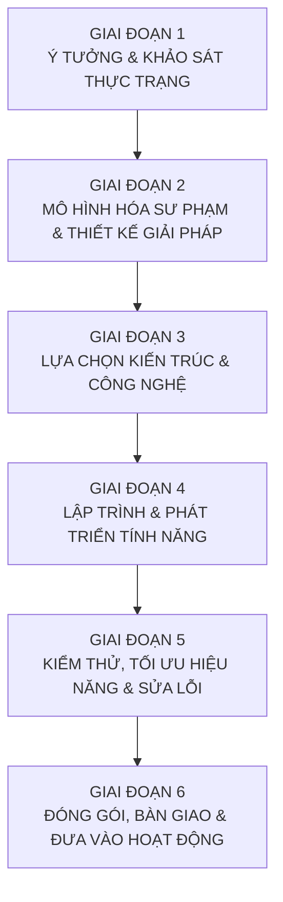
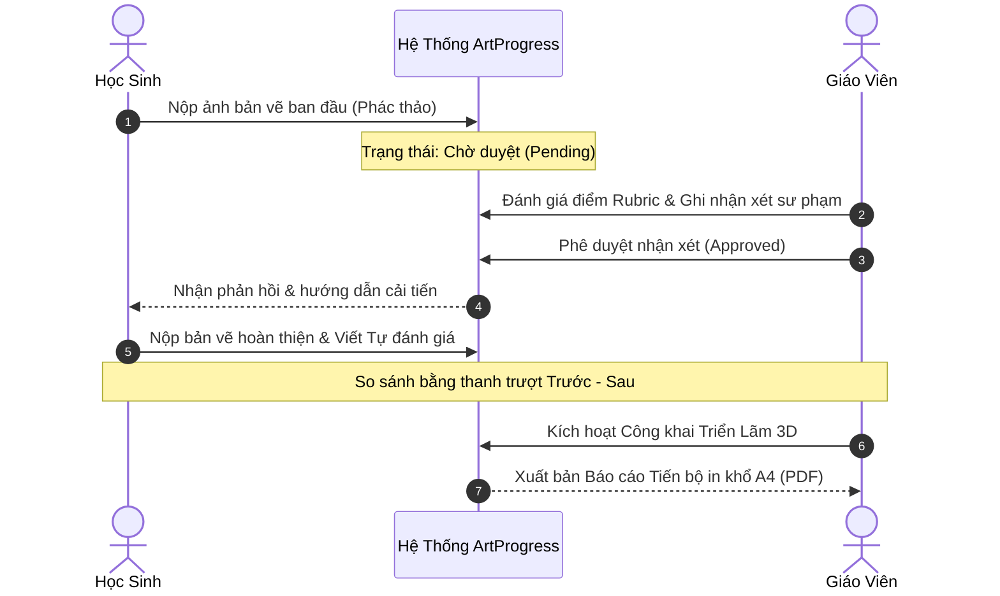
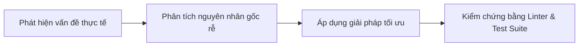

# 📑 BÁO CÁO QUY TRÌNH THỰC HIỆN DỰ ÁN TỪ ĐẦU ĐẾN CUỐI
# ARTPROGRESS (v1.0.0) — HỆ THỐNG QUẢN LÝ HỒ SƠ & TRIỂN LÃM MĨ THUẬT 3D THCS

> **Người thực hiện**: Học sinh phụ trách dự án công nghệ mĩ thuật  
> **Người hướng dẫn / Tiếp nhận**: Giáo viên Mĩ thuật THCS  
> **Phạm vi áp dụng**: 4 Khối (6, 7, 8, 9) & 16 Lớp học THCS  
> **Phiên bản phát hành**: v1.0.0  
> **Năm học**: 2025 – 2026

---

## 🧭 SƠ ĐỒ TỔNG THỂ QUY TRÌNH DỰ ÁN (6 GIAI ĐOẠN)

---

## 📌 GIAI ĐOẠN 1: Ý TƯỞNG & XÁC ĐỊNH BÀI TOÁN THỰC TIỄN

### 1.1. Thực trạng dạy và học môn Mĩ thuật tại trường THCS
- **Khó khăn trong lưu trữ**: Tranh vẽ của học sinh vẽ trên giấy A3/A4 dễ bị quăn mép, ẩm mốc, thất lạc qua các học kỳ.
- **Khó khăn trong đánh giá tiến bộ**: Giáo viên khó lưu lại bản phác thảo ban đầu để so sánh trực quan với bản vẽ hoàn thiện của học sinh.
- **Hạn chế của phòng triển lãm thực tế**: Không gian phòng học có hạn, chi phí đóng khung kính và treo tranh tốn kém, phụ huynh khó tiếp cận xem tranh của con em mình.

### 1.2. Định hướng đổi mới theo Chương trình GDPT 2018
- Chuyển từ đánh giá cho điểm số đơn thuần sang **"Đánh giá vì sự tiến bộ của người học" (Assessment for Learning)**.
- Xây dựng **Hồ sơ học tập mĩ thuật (Art Portfolio)** cá nhân hóa cho từng học sinh.
- Ứng dụng công nghệ thông tin và chuyển đổi số trong giáo dục nghệ thuật.

### 1.3. Mục tiêu đặt ra cho dự án
- Xây dựng một trang web dễ sử dụng, phân quyền rõ ràng cho Giáo viên, Học sinh và Khách tham quan.
- Tích hợp bảng tiêu chí Rubric chuẩn sư phạm.
- Tích hợp thanh trượt so sánh tranh Trước - Sau sống động.
- Dựng một **Phòng Triển Lãm Ảo 3D** chân thực như bảo tàng quốc tế để tôn vinh tác phẩm của học sinh.

---

## 📐 GIAI ĐOẠN 2: MÔ HÌNH HÓA SƯ PHẠM & THIẾT KẾ GIẢI PHÁP

### 2.1. Thiết kế cơ cấu trường học THCS
- **Phạm vi**: 4 Khối lớp (Khối 6, Khối 7, Khối 8, Khối 9).
- **Quy mô**: 16 Lớp học (`6A1`, `6A2`, `6A3`, `6A4` ... đến `9A4`).
- **Danh tính học sinh**: Mỗi học sinh có Mã định danh cá nhân và một sắc tố màu mỹ thuật (*Atelier Pigment*) đại diện.

### 2.2. Xây dựng Bảng tiêu chí Rubric chuẩn GDPT 2018
Thiết lập 4 tiêu chí năng lực cốt lõi với tổng trọng số 100%:
1. **Bố cục & Trọng tâm** (25%): Xác định mảng chính, mảng phụ hài hòa.
2. **Đường nét & Tạo hình** (25%): Nét vẽ biểu cảm, vững vàng, thể hiện đúng đặc điểm mẫu.
3. **Màu sắc & Hòa sắc** (30%): Phối màu phù hợp chủ đề, có độ tương phản và hòa sắc đẹp mắt.
4. **Sáng tạo & Cảm xúc** (20%): Ý tưởng độc đáo, góc nhìn mới mẻ và tình cảm chân thực.

### 2.3. Thiết kế quy trình phản hồi hai chiều (Human-in-the-Loop)

---

## 💻 GIAI ĐOẠN 3: LỰA CHỌN CÔNG NGHỆ & THIẾT KẾ GIAO DIỆN

| Thành phần | Công nghệ lựa chọn | Lý do lựa chọn |
| :--- | :--- | :--- |
| **Framework nền tảng** | **Next.js 16 (App Router) + React 19** | Nền tảng web hiện đại nhất thế giới, tải trang tức thì, hỗ trợ Server-Side Rendering (SSR) |
| **Ngôn ngữ lập trình** | **TypeScript** | Định kiểu dữ liệu chặt chẽ, an toàn, không lo lỗi biến hay lỗi kiểu dữ liệu |
| **Không gian ảo 3D** | **Three.js (WebGL Engine)** | Dựng môi trường 3D thời gian thực chạy trực tiếp trên trình duyệt, không cần cài đặt plugin |
| **Thiết kế giao diện** | **Tailwind CSS + Lucide Icons** | Giao diện hiện đại, tối giản, thanh lịch theo phong cách xưởng vẽ nghệ thuật |
| **Chuyển động nghệ thuật** | **CSS GPU Compositor Keyframes** | Xử lý hoạt ảnh vệt cọ vẽ `#C4572F` mượt mà 60/120fps trên luồng phần cứng |
| **Lưu trữ dữ liệu** | **Local Storage + Cloud Firestore** | Chế độ lưu trữ kép (*Graceful Fallback*): Hoạt động trơn tru cả khi mất mạng |
| **Kiểm soát phiên bản cache**| **App Version Tag (v1.0.0)** | Tự động so sánh phiên bản, xóa sạch cache cũ và reload sạch khi có cập nhật |

---

## 🔨 GIAI ĐOẠN 4: LẬP TRÌNH & PHÁT TRIỂN TÍNH NĂNG CHI TIẾT

### 4.1. Cổng đăng nhập phân quyền (`LoginPage.tsx`)
- Giao diện 3 tab chuyển đổi nhanh: **Giáo viên**, **Học sinh**, **Khách**.
- Tab Giáo viên: Bảo mật bằng mã PIN sư phạm, hỗ trợ nút bấm điền nhanh `123456`.
- Tab Học sinh: Bộ lọc Khối $\rightarrow$ Lớp $\rightarrow$ Tìm kiếm tên học sinh thông minh.
- Tab Khách: Mở cửa tự do một chạm, không rào cản.

### 4.2. Hiệu ứng nhận diện thương hiệu vệt cọ vẽ (`BrushStrokeTransition.tsx`)
- **Tông màu**: Sắc cam son đất nung `#C4572F` đặc trưng của mĩ thuật truyền thống và hiện đại.
- **Chất liệu cọ vẽ**: Thiết kế bằng vector SVG chi tiết cao, gồm 7 múi tơ cọ uốn lượn, viền sơn ướt bắt sáng `#E2744C` và các giọt bắn sơn ngẫu nhiên.
- **Nhịp điệu dứt khoát 3 giai đoạn**:
  - *Giai đoạn 1 (1.0s)*: Vệt cọ vút mạnh mẽ từ phải sang trái che phủ toàn màn hình.
  - *Giai đoạn 2 (0.8s)*: Giữ nguyên màn hình phủ kín màu sơn son, dấu ấn xưởng vẽ ArtProgress THCS tỏa sáng; hệ thống hoán đổi giao diện ngầm bên dưới mà không chớp giật.
  - *Giai đoạn 3 (0.5s)*: Vệt cọ trượt rút về lại bên phải, để lộ giao diện xưởng vẽ chính.

### 4.3. Hồ sơ bài vẽ & Thanh trượt Before/After (`BeforeAfterViewer.tsx`)
- Tích hợp thanh trượt chia đôi màn hình tương tác chuột/cảm ứng.
- Cho phép kéo qua lại giữa ảnh Trước và ảnh Sau để quan sát sự lột xác của bức tranh.

### 4.4. Xây dựng Phòng Triển Lãm Mỹ Thuật 3D (`Gallery3DView.tsx`)
- **Kiến trúc phòng**: Tường thạch cao mỹ thuật `0xF7F4ED`, sàn gỗ sồi ấm áp tự sinh vân, nẹp viền đen góc tường, phào chỉ trần và chân tường.
- **Hệ thống ánh sáng bảo tàng**:
  - Đèn LED âm trần tròn trung tâm phát quầng sáng mịn màng.
  - Cụm đèn rọi ray (`track spotlights`) tính toán góc quay toán học chính xác 100% hướng thẳng vào tâm từng bức tranh.
  - Ánh sáng vòm `HemisphereLight` kết hợp `AmbientLight` giúp tranh bừng sáng rõ nét.
- **Khung tranh co giãn tự động**: Khung gỗ sồi đen dày 7cm kết hợp nẹp chỉ vàng kim loại 3cm ôm sát mép toan tranh theo đúng tỉ lệ ảnh tự nhiên (loại bỏ hoàn toàn viền trắng thừa thãi).

### 4.5. Xuất bản báo cáo minh chứng in A4 (`ProgressReportModal.tsx`)
- Tự động ẩn thanh công cụ khi in (`print:hidden`).
- Bố cục trang A4 chuẩn xác: Tiêu đề trường, thông tin học sinh, minh chứng ảnh Trước - Sau, bảng điểm Rubric, nhận xét của giáo viên và tự đánh giá của học sinh.

### 4.6. Cơ chế kiểm soát phiên bản tự động (v1.0.0)
- Định nghĩa tập trung tại duy nhất một nơi: [`src/config/version.ts`](file:///d:/webgd/src/config/version.ts).
- Lưu mã phiên bản hiện tại vào Local Storage (`artprogress_app_version`).
- Tự động phát hiện khi người dùng mở trang từ bản cache cũ, thực hiện dọn sạch bộ nhớ cache và reload sạch sẽ để cập nhật bundle mới nhất.

---

## 🧪 GIAI ĐOẠN 5: KIỂM THỬ, TỐI ƯU HIỆU NĂNG & SỬA LỖI CHUYÊN SÂU

Trong quá trình phát triển, dự án đã trải qua các đợt kiểm thử và khắc phục lỗi thực tế:

### 5.1. Khắc phục lỗi Hydration Mismatch của Next.js SSR
- **Vấn đề**: Khi người dùng tải lại trang, React báo lỗi bất đồng bộ HTML giữa máy chủ (SSR) và trình duyệt (Client).
- **Nguyên nhân**: Hàm khởi tạo `useState` đọc trực tiếp `sessionStorage` trong lúc server chưa có đối tượng `window`.
- **Giải pháp**: Chuẩn hóa state khởi tạo mặc định đồng nhất, đưa logic khôi phục phiên vào `useEffect` qua async microtask và sử dụng cờ `hasHydrated` để đảm bảo cây DOM ban đầu khớp 100%.

### 5.2. Tối ưu hiệu năng phòng tranh 3D (Triệt tiêu giật lag)
- **Vấn đề**: Di chuyển nhân vật trong phòng 3D có hiện tượng sụt khung hình.
- **Giải pháp**:
  - Thay thế vật liệu PBR nặng nề bằng `MeshLambertMaterial` nhẹ hơn hàng nghìn lần.
  - Tái sử dụng chung Geometry và Material giữa các khung đèn và viền tranh (giảm thiểu Draw Calls).
  - Khởi tạo sẵn các vector tĩnh (`_vCurLook`, `_vForward`...) để triệt tiêu việc cấp phát bộ nhớ rác (Zero GC Spikes).
  - Bổ sung đầy đủ hàm `.dispose()` giải phóng bộ nhớ GPU khi đổi trang.

### 5.3. Khắc phục lỗi vị trí camera khi xem chi tiết tranh
- **Vấn đề**: Khi bấm xem chi tiết bức tranh, vị trí nhân vật bị dịch chuyển về điểm xuất phát.
- **Giải pháp**: Tách biệt trạng thái hiển thị Modal chi tiết khỏi vòng đời khởi tạo lại Three.js Scene, duy trì tọa độ camera ổn định.

### 5.4. Tự động hóa kiểm thử (Automated Unit Testing)
- Xây dựng file kiểm thử tự động [`src/lib/__tests__/artprogress.node-test.mjs`](file:///d:/webgd/src/lib/__tests__/artprogress.node-test.mjs).
- Kiểm tra 12 trường hợp nghiệp vụ sư phạm cốt lõi:
  1. Tổng trọng số Rubric 4 tiêu chí bắt buộc bằng 100%.
  2. Quy trình phê duyệt Human-in-the-Loop mặc định `pending_moderation`.
  3. Quyền riêng tư của tranh mặc định `isPublic = false`.
  4. Học sinh chỉ thấy nhận xét sau khi giáo viên duyệt.
  5. Chỉ tác giả mới có quyền nộp bản vẽ cải tiến.
  6. Điều kiện xuất hiện tranh trên triển lãm 3D.
  7. Quyền đóng/mở nhận bài nộp của giáo viên.
  8. Tính năng tùy biến tiêu chí Rubric bài học.
  9. Cơ chế chuyển đổi tự động Graceful Fallback khi mất mạng.
  10. Đầy đủ thành phần báo cáo minh chứng tiến bộ sư phạm A4.
  11. Bộ lọc phân loại chủ đề theo đúng khối lớp.
  12. Định dạng in ấn PDF che giấu thanh menu.
- **Kết quả**: **12/12 kiểm thử đạt tiêu chuẩn tuyệt đối (PASS 100%)**.

---

## 🚀 GIAI ĐOẠN 6: ĐÓNG GÓI, BÀN GIAO & VẬN HÀNH THỰC TẾ

### 6.1. Kiểm định mã nguồn trước khi xuất xưởng
- **Linter**: `npm run lint` $\rightarrow$ **0 lỗi, 0 cảnh báo** (Tuân thủ chuẩn React 19).
- **Build Production**: `npm run build` với Next.js 16 Turbopack $\rightarrow$ **Thành công 100% trong 4.1 giây**.

### 6.2. Tài liệu bàn giao hoàn chỉnh
1. **Mã nguồn dự án**: Tổ chức khoa học, tách bạch components và thư viện tiện ích.
2. **Cẩm nang sử dụng**: File [`HUONG_DAN_SU_DUNG.md`](file:///d:/webgd/HUONG_DAN_SU_DUNG.md) hướng dẫn chi tiết từng bước cho Thầy/Cô và Học sinh.
3. **Báo cáo quy trình thực hiện**: File [`QUY_TRINH_THUC_HIEN_DU_AN.md`](file:///d:/webgd/QUY_TRINH_THUC_HIEN_DU_AN.md) làm tài liệu minh chứng nghiên cứu khoa học kỹ thuật.

### 6.3. Kế hoạch phát triển trong tương lai
- Kết nối thêm trợ lý AI gợi ý hòa sắc và phân tích đường nét hỗ trợ học sinh tự học tại nhà.
- Mở rộng thêm chế độ kính thực tế ảo (VR Mode) cho phòng triển lãm 3D.
- Tổ chức các cuộc thi vẽ tranh liên trường trực tuyến trên nền tảng ArtProgress.

---

*Hết báo cáo quy trình.*
